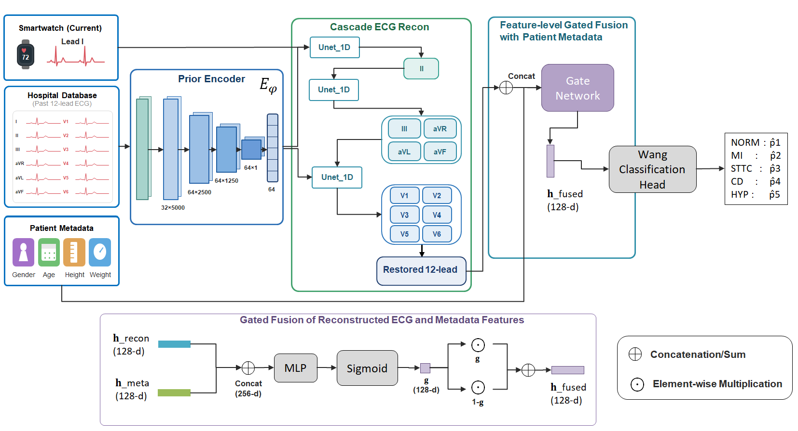
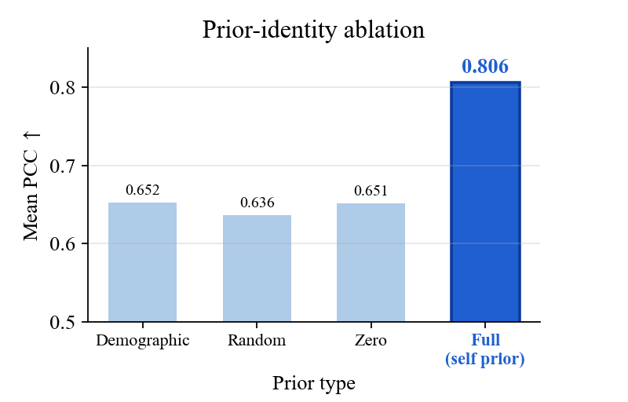
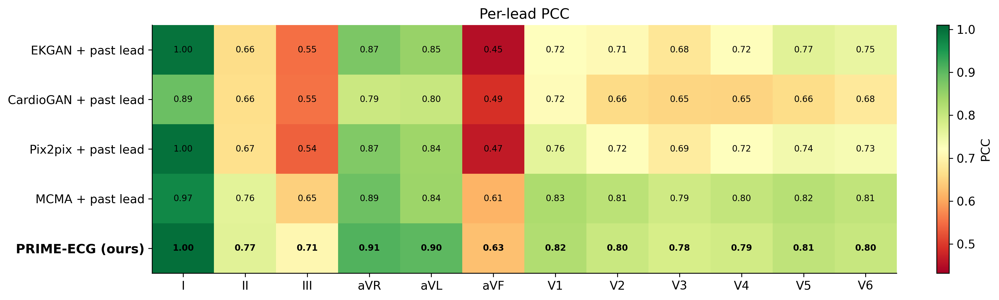

# PRIME-ECG: Leveraging Previous Records and Individual Metadata for Enhanced 12-Lead ECG Reconstruction and Diagnosis

[](https://pytorch.org/)
[]()
[]()
[](paper/PRIME-ECG_Paper_2026.pdf)

> **의료융합형 멀티모달 프로젝트 (Medical Multimodal AI Project — Team 6, Chung-Ang University)**  
> **단일 유도(Wearable Lead I) 심전도 + 환자 과거 12-Lead 심전도(Prior) + 환자 메타데이터(Gated Fusion)를 결합한 개인 맞춤형 12-Lead ECG 계층적 복원 및 심혈관 질환 진단 프레임워크**

---

## 📌 Overview & Motivation

스마트워치 등 웨어러블 기기가 측정하는 **단일 유도 심전도(Lead I)** 는 일상 속 연속 모니터링에 유리하지만, 심장의 3차원 전기생리학적 활동을 12개 방향에서 기록하는 임상 표준 **12-Lead ECG** 에 비해 공간적 정보가 부족합니다(예: 하벽 심근경색 진단에 필수적인 Lead III, aVF 및 전흉부 유도 V1–V6). 기존의 단일 유도 기반 복원 모델들은 환자 고유의 파형 형태(Patient-specific Morphology)를 복원하지 못하고 집단 평균 파형(Population-average Waveform)으로 수렴하는 한계가 있었습니다.

**PRIME-ECG (Previous Records and Individual Metadata for Enhanced 12-Lead ECG Reconstruction and Diagnosis)** 는 병원 전자의무기록(EHR)에 보관된 **동일 환자의 과거 12-Lead ECG 기록($X^p$)** 과 **환자 개인 메타데이터(나이, 성별, 키, 체중)** 를 결합하여 이 문제를 해결합니다:

1. **Prior Encoder & FiLM Conditioning**: 환자의 과거 12-Lead ECG($12 \times T$)를 경량 1D-CNN 인코더($E_\phi$)로 64차원 환자 고유 형태 벡터로 압축하고, **FiLM (Feature-wise Linear Modulation)** 을 통해 복원 U-Net의 보틀넥 특징 맵을 채널별로 변조합니다.
2. **Einthoven–Goldberger 물리 법칙 기반 Cascade Decoder**: 12개 리드를 독립적으로 예측하는 대신, 심전도의 전기생리학적 의존 구조(**Lead I → Lead II → 사지유도(III, aVR, aVL, aVF) → 흉부유도(V1–V6)**)를 따르는 계층적(Cascade) 복원을 수행하여 파형 정확도와 물리적 일관성(Physical Consistency)을 동시에 달성합니다.
3. **Downstream Gated Multimodal Diagnostic Classifier**: 복원된 12-Lead ECG 특징(ResNet1D-LSTM)과 환자 메타데이터 임베딩(MLP)을 **Gated Fusion Network** 로 적응적 결합하여 5대 심혈관 질환 슈퍼클래스(`NORM`, `MI`, `STTC`, `CD`, `HYP`) 진단 성능을 극대화합니다.

<p align="center">
  
</p>

---

## 📊 Key Experimental Results

### 1. PTB-XL 12-Lead 복원 및 하류 질환 분류 성능 (5-Seed 평균)

경쟁 베이스라인 모델 대비 **가장 적은 파라미터(7.9M)** 로 가장 높은 파형 복원 정확도(**PCC 0.806, MSE 0.442**)와 하류 질환 분류 성능(**AUROC 0.829 → 메타데이터 결합 시 0.837, F1 0.621**)을 달성했습니다.

| Method | Params | Reconstruction PCC ↑ | Reconstruction MSE ↓ | Physics Violation ($\times 10^{-3}$) ↓ | Classification AUROC ↑ | Classification F1 ↑ |
|---|---:|---:|---:|---:|---:|---:|
| CardioGAN | 58.1M | 0.657 | 0.755 | 52.6 ± 0.7 | 0.770 | 0.310 |
| EKGAN | 26.1M | 0.718 | 0.622 | 434.3 ± 41.1 | 0.797 | 0.506 |
| Pix2pix | 13.9M | 0.687 | 0.652 | 42.2 ± 1.3 | 0.793 | 0.526 |
| MCMA | 18.2M | 0.747 | 0.591 | 138.6 ± 1.3 | 0.810 | 0.507 |
| **PRIME-ECG (Ours, ECG only)** | **7.9M** | **0.806** | **0.442** | **5.4 ± 0.6** | **0.829** | **0.570** |
| **PRIME-ECG + Metadata (Gated Fusion)** | **7.9M** | **0.806** | **0.442** | **5.4 ± 0.6** | **0.837** | **0.621** |
| *Real 12-Lead ECG (Upper Bound)* | - | - | - | - | *0.889* | *0.656* |

### 2. 환자 고유 Prior 검증 & 시간 경과(Temporal Gap) 강건성

- **Prior Type Ablation**: 환자 본인의 과거 ECG(`Self Prior`, PCC **0.806**)를 인구통계학적 매칭 타인(`Demographic`, 0.652), 무작위 타인(`Random`, 0.636), 영벡터(`Zero`, 0.651)로 대체하면 성능이 급격히 하락하여, 모델이 실제로 **환자 고유의 해부학적·전기생리학적 특성**을 활용함을 입증했습니다.
- **Temporal Gap Robustness**: 과거 기록과 현재 측정 사이의 시간 간격이 당일(`0–1d`)부터 1년 이상(`1y+`)까지 벌어져도 평균 PCC **0.794 ~ 0.843**을 일관되게 유지합니다.
- **MIMIC-IV-ECG Zero-Shot 일반화**: PTB-XL로만 학습된 모델을 외부 대규모 병원 데이터셋인 **MIMIC-IV-ECG** 에 별도 파인튜닝 없이 Zero-Shot 평가한 결과, 최고 복원 성능(**PCC 0.642, MSE 0.603**) 및 최고 Macro-F1(**0.3312**)을 기록했습니다.

<p align="center">
  
  
</p>

---

## 📁 Repository Structure

```text
PRIME-ECG/
├── prime_ecg.py                       # PRIME-ECG 독립 실행 모듈 (PriorEncoder + FiLM CascadeECGRecon + CLI)
├── cascade_recon.py                   # Einthoven-Goldberger Cascade & Vanilla 1D U-Net 아키텍처 및 손실 함수
├── models/
│   ├── resnet1d_wang.py               # 12-Lead ECG 하류 질환 분류기 (ResNet1D-LSTM)
│   ├── resnet1d_wang_gated.py         # 복원 12-Lead ECG + 환자 메타데이터 Gated Fusion 분류기
│   └── baselines/                     # 비교 실험용 베이스라인 모델 구현체 모음
│       ├── mcma_unet3plus.py          # MCMA (UNet3+ 기반 멀티채널 복원)
│       ├── beatdiff_1to12.py          # BeatDiff (확산 모델 기반 ECG 복원)
│       ├── diffusion_1to12.py         # Conditional Diffusion 1-to-12 baseline
│       ├── ecgrecover_ummisco.py      # ECGRecover 아키텍처
│       ├── explainable_1to12.py       # Explainable Lead-Reconstruction 모듈
│       ├── leadfield_1to12.py         # 물리 Leadfield 기반 복원 모델
│       ├── unet1d_baseline.py         # 1D U-Net 베이스라인
│       └── vae_zehui.py / gan_zehui.py / lstm_zehui.py
├── scripts/
│   ├── train_cascade_prior.py         # PRIME-ECG (Prior-Conditioned Cascade) 학습 스크립트
│   ├── infer_cascade_prior.py         # 테스트셋 복원 추론, 샘플 시각화 및 리드별 MAE/PCC 산출
│   ├── train_cascade.py               # 단일 시점 Cascade / Vanilla 베이스라인 학습
│   ├── infer_cascade.py               # 단일 시점 Cascade 추론
│   ├── prime_ecg_full_experiments.py  # 전체 베이스라인·Prior Ablation·Temporal Gap·질병별 리드 선택 통합 실험 드라이버
│   ├── eval_physics.py                # Einthoven-Goldberger 물리 법칙 위배도(Physics Violation) 정량 평가
│   ├── uncertainty_checks.py          # 복원 불확실성 및 보정(Calibration) 분석
│   ├── make_physics_figures.py        # 논문용 물리 일관성 시각화 생성
│   ├── make_prior_bar.py              # Prior Ablation 비교 플롯 생성
│   └── visualize_facet_results.py     # 리드별/질환별 성능 및 Temporal Gap 종합 시각화
├── results/                           # 주요 실험 정량 결과 테이블 (CSV / JSON)
│   ├── reconstruction_results.csv
│   ├── reconstruction_results_prior.csv
│   ├── temporal_gap_results.csv
│   ├── meta_stats.json
│   └── experiment_environment.csv
├── figures/                           # 논문 및 분석 결과 고해상도 Figure 모음
├── paper/
│   ├── PRIME-ECG_Paper_2026.pdf       # 프로젝트 최종 논문 전문 (15 pages, Appendix 포함)
│   └── PRIME-ECG_Abstract.pdf         # 논문 요약본 (국/영문 병기)
├── Dockerfile                         # GPU 재현 환경을 위한 Docker 이미지 정의
└── requirements.txt                   # 필수 Python 패키지 목록
```

---

## 🚀 Getting Started

### 1. 환경 설정 (Installation)

```bash
git clone https://github.com/e2dus/PRIME-ECG.git
cd PRIME-ECG
pip install -r requirements.txt
```

데이터셋은 PhysioNet의 [PTB-XL (v1.0.3)](https://physionet.org/content/ptb-xl/1.0.3/)을 사용합니다.

### 2. 모델 단독 사용 예시 (Quick Python API)

```python
import torch
from prime_ecg import make_prime_ecg, load_prime_ecg

# 1) 모델 초기화 (또는 학습된 체크포인트 로드)
model = make_prime_ecg(base_ch=32, res_base_ch=16, prior_dim=64)

# 2) 입력 텐서 준비: 현재 Lead I (B, 1, 1000) & 과거 12-Lead ECG (B, 12, 1000)
lead_i = torch.randn(4, 1, 1000)
past_12lead = torch.randn(4, 12, 1000)

# 3) 환자 맞춤형 12-Lead ECG 복원
recon_12lead = model(lead_i, past_12lead=past_12lead)  # Output shape: (4, 12, 1000)
```

### 3. 학습 및 추론 (Training & Inference)

**Prior-Conditioned Cascade 모델 학습:**

```bash
python scripts/train_cascade_prior.py \
  --data_dir /path/to/ptb-xl/1.0.3/ \
  --output_dir ./outputs/prime_ecg \
  --use_meta \
  --teacher_forcing \
  --epochs 30 \
  --batch_size 32
```

**테스트셋 추론 및 리드별 정량 평가:**

```bash
python scripts/infer_cascade_prior.py \
  --data_dir /path/to/ptb-xl/1.0.3/ \
  --ckpt_dir ./outputs/prime_ecg \
  --ckpt_name best.pt \
  --save_plots 10
```

**전체 비교 실험 및 Ablation Suite 실행:**

```bash
python scripts/prime_ecg_full_experiments.py \
  --methods lead_i,mcma,ecgrecover,ekgan,mcma_prior,ekgan_prior,concat,prime_ecg \
  --data_dir /path/to/ptb-xl/1.0.3/ \
  --output_dir ./outputs/full_benchmark
```

---

## 👥 Authors

- **Team 6 (의료융합형 멀티모달 프로젝트, 중앙대학교 AI학과)**: 권유환, 김대현, 유효립, **정의연 (Ui-Yeon Jeong)**
- 📄 Full Paper: [`paper/PRIME-ECG_Paper_2026.pdf`](paper/PRIME-ECG_Paper_2026.pdf)
